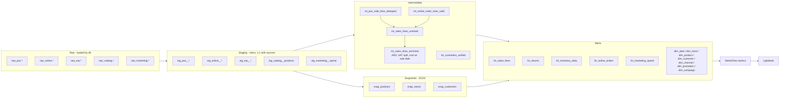
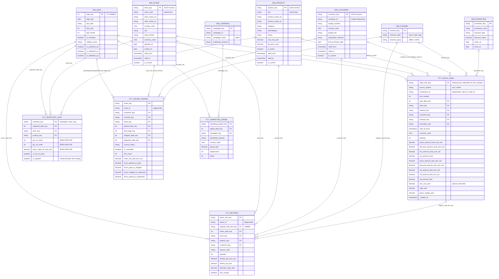

# Target Data Model — Star Schema

Diagrams are written in Mermaid, which GitHub renders. The source-system schemas are described in [source_systems.md](source_systems.md).
Export an `erd.png` from dbdiagram.io or draw.io for the README once the marts are built.

## Lineage by layer

## Star schema

